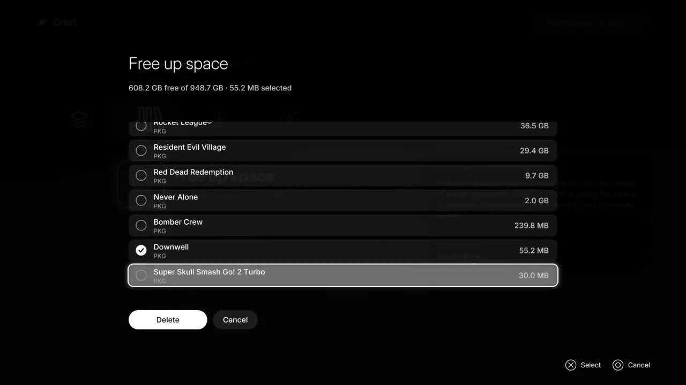

# Orbit Store 0.2.0 (Beta)

> **🎉 OrbitNet is coming soon: online multiplayer for jailbroken PS5s.** From the developer of Orbit. Follow along at [getorbitnet.com](https://getorbitnet.com).

**Orbit can now free up space for a download and download files from links.**

## Orbit Store · PS4

- **Free up space.** When a download doesn’t fit on its drive, **Download** now opens **Not enough space** instead of staying greyed out. It lists what can go from that drive, biggest first: packages the PS4 has already installed, archives kept after unpacking and cancelled downloads, then your installed games. Orbit ticks only its own files; tick a game to uninstall it. Orbit deletes them one at a time, then starts the download. Saves are not touched, and a game whose package you kept can be installed again from **Downloads**. **Free up space** is also in Library, and on a download paused without room to unpack.
- **Download from links.** In Downloads, select **Download from links** and paste up to 20 direct download links. Orbit checks each one and adds it to Downloads; ZIP, 7z and RAR files unpack like games. If a link expires, **Replace link** takes a fresh one and keeps the part already downloaded.
- **Vikingfile fix.** Vikingfile moved its download pages to a new address. Orbit now follows it, in the TV app and in the browser version.
- **TorBox.** When TorBox’s download server can’t be reached, Orbit asks TorBox for a fresh link up to 3 times, then suggests a different CDN in your TorBox settings.
- **Recently added.** Browse can now sort games by when they were added to Orbit.
- Other improvements and bug fixes.

## Orbit Zero · Mac, Windows and Linux

- **Free up space,** as on the PS4. For a download that goes through your computer, Zero first checks that it can start, so nothing is deleted for a download that can’t.
- **Download from links** and **Replace link,** as on the PS4.
- **Sort by Recently added** in Browse.

> **Orbit stays free.** [Orbit Store](https://github.com/saawant12/orbit-store-ps4), [Orbit Zero](https://github.com/saawant12/orbit-store-ps5#orbit-zero-for-mac-windows-and-linux), [Orbit Play](https://github.com/saawant12/orbit-play-ps5) and our upcoming apps are free and will stay free.
>
> I’ve been building Orbit in my own time and covering the costs of AI tools, test consoles, hardware and servers. If you’d like to help, you can [support Orbit via crypto](https://github.com/saawant12/orbit-store-ps5/issues/131#user-content-support-with-crypto). It’s entirely optional.

[Get started on PS4](https://github.com/saawant12/orbit-store-ps4/blob/main/guides/getting-started.md) · [Use Orbit Zero with your PS4](https://github.com/saawant12/orbit-store-ps4/blob/main/guides/orbit-zero.md)

  

 

## What you need

A PS4 with GoldHEN. Turn on GoldHEN’s payload loader once, in **GoldHEN → Servers Settings → Enable PayLoader Server**, so Orbit can start. For Orbit Zero, a Mac, Windows or Linux computer on the same home network as your PS4, over Wi-Fi or Ethernet.

## Install or update the native TV app (PKG)

Download `orbit_store_ps4.pkg` from **Assets**, verify its `.sha256`, and copy it to your PS4 on a USB drive. Install it with GoldHEN’s **Settings → Debug Settings → Package Installer**, then open **Orbit Store** from the Games row. Native app **0.2.0** includes the matching Orbit Store **0.2.0** service and elfldr.

Close other apps such as ezRemote before opening Orbit. With them open, the PS4 may not have enough memory left to start it.

## Use Orbit Zero with your PS4

Download the `Orbit-Zero-1.9.7-*` package for your computer from **Assets**: macOS DMG, Windows installer or ZIP, or Ubuntu/Debian DEB, for ARM64 or x64. Open Orbit on your PS4, then in Orbit Zero go to **Settings → Devices**, enter your PS4’s IP address, select **Connect to Orbit** and enter the code shown on your PS4. [Step-by-step guide](https://github.com/saawant12/orbit-store-ps4/blob/main/guides/orbit-zero.md)

Orbit Zero 1.9.7 works with your PS5 too.

## Use the browser version (ELF)

Download `orbit_store.elf` and its `.sha256` from **Assets**, verify the checksum, then send the ELF once to an ELF loader on port 9021, such as elfldr. GoldHEN’s own payload loader on port 9090 can’t run it; it’s too big. Orbit saves its service and elfldr, and adds the **Orbit Store Browser** icon. Open it, or `http://<ps4-ip>:34177/` on another device on the same local network.

To start Orbit when the PS4 turns on, see [Payload manager and auto-start](https://github.com/saawant12/orbit-store-ps4/blob/main/guides/getting-started.md#payload-manager-and-auto-start).

## Good to know

- **Get everything installs in order.** Each download waits for the one before it to install. If one fails or isn’t installed, the ones after it stay downloaded and wait for you to install them from Downloads.
- Updates are offered only for the title ID of the installed game, so a copy from another region gets none. Orbit can’t tell which DLC you already have, so Get everything ticks all of it; untick what you have.
- Right after the PS4 turns on, Orbit sometimes needs a second try to start. The app and the auto-start copy try again by themselves, so the first start can take up to about 40 seconds longer.
- **Without Orbit Zero, Vikingfile and AkiraBox still take a few minutes.** On PS4, the Cloudflare check on their pages can take 2–3 minutes to pass. Leave the page open: once the check passes, the download works as usual. With a Vikingfile Premium account [signed in to Orbit](https://github.com/saawant12/orbit-store-ps4/blob/main/guides/vikingfile.md), there’s usually no wait.
- AkiraBox may show an ad instead of the download. Close it and try again, or choose another source for the game.
- Orbit Zero uses one console at a time. Finish or cancel the transfers to one console before switching to the other.
- Scores and playtimes come from published Metacritic and HowLongToBeat data. Games without them show none; playtimes are community estimates and vary by player.

## Downloads and source

- **PS4:** `orbit_store_ps4.pkg` includes the native TV app, the download service and elfldr. Use `orbit_store.elf` to run the service and browser interface on their own.
- **Mac, Windows and Linux:** choose the `Orbit-Zero-1.9.7-*` package for your operating system and processor. Orbit Zero includes Orbit for PS5 1.9.7, whose source code is in `orbit-store-1.9.7-source-bundle.zip` in this release’s **Assets**, and elfldr a481740, whose source code is in `orbit-store-0.2.0-source-bundle.zip`.
- **Source code:** `orbit-store-0.2.0-source-bundle.zip` includes the Store source code, dependencies, elfldr’s source, licence notices and build instructions.
- **Checksums:** use `SHA256SUMS` to check your download, or run `shasum -a 256 -c <filename>.sha256` for the ELF or PKG.

  

